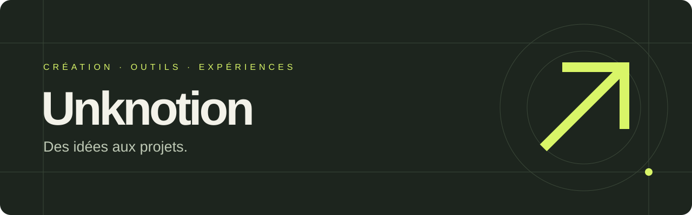

# Des idées aux projets.

Je crée des outils et des expériences pour passer d'une intuition à quelque chose que l'on peut utiliser, tester et partager.

Mes terrains d'exploration : **conception créative, prompts structurés et outils numériques simples**. L'IA fait partie de mon processus de création ; la clarté et l'utilité guident le résultat.

## À découvrir : Déclic ↗

**Une idée floue entre. Un brief créatif et un prompt structuré en sortent.**

Déclic est un outil interactif en français pour cadrer une marque, préparer un contenu ou définir un produit numérique. Sans compte, sans clé API et sans envoi des saisies à un serveur.

| Le besoin | La réponse |
| :--- | :--- |
| « J'ai une idée, mais je ne sais pas par où commencer. » | Un questionnaire court pour préciser le public, l'objectif et les contraintes. |
| « Je ne sais pas quoi demander à l'IA. » | Un prompt structuré qui demande trois directions, un choix argumenté et un livrable. |
| « Je veux repartir avec quelque chose. » | Un brief et un prompt à copier ou exporter en Markdown. |

**[Découvrir Déclic et l'essayer →](https://github.com/Unknotion/declic)** · **[Lire l'étude de cas →](https://github.com/Unknotion/declic/blob/main/CASE-STUDY.md)**

## Ce que mes projets cherchent à montrer

- **Clarifier** : transformer une envie vague en problème concret.
- **Concevoir** : organiser une méthode dans un parcours compréhensible.
- **Donner une forme** : soigner les mots, l'interface et la présentation.
- **Partager** : livrer un outil documenté, avec ses exemples et ses limites.

## Une démarche visible

Chaque projet mérite davantage qu'un beau titre : un problème expliqué, une démonstration utilisable et des choix documentés. Déclic ouvre cette collection. Les prochaines réalisations seront ajoutées ici quand elles seront prêtes.

## Une idée à explorer ensemble ?

[Ouvrir une discussion de projet](https://github.com/Unknotion/Unknotion/issues/new?template=projet.md) avec le besoin, le public et le résultat recherché. Les échanges dans les issues sont publics : n'y partagez pas d'informations confidentielles.

---

Unknotion · Curiosité, intention, réalisation.

